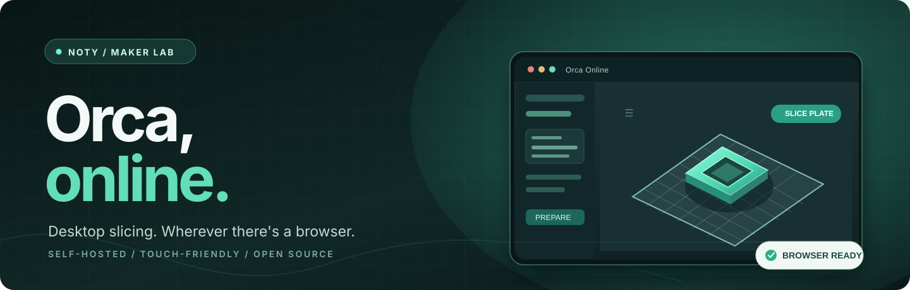
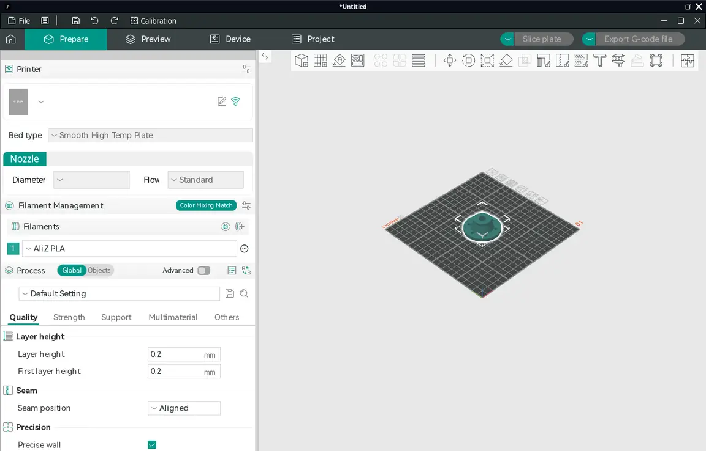
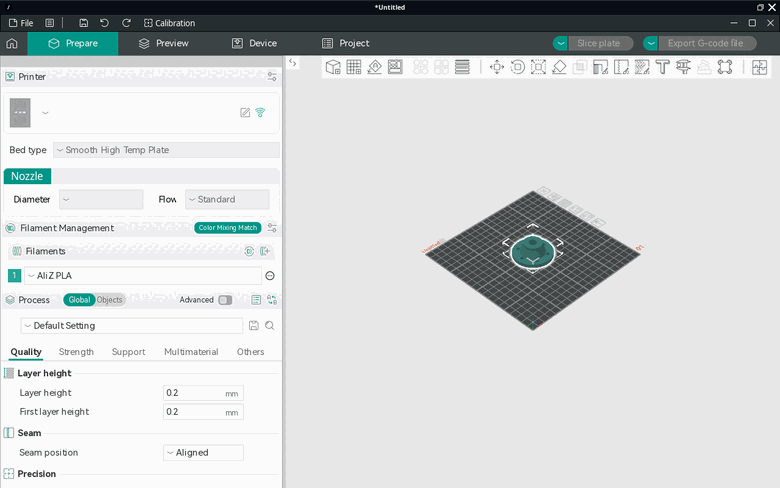
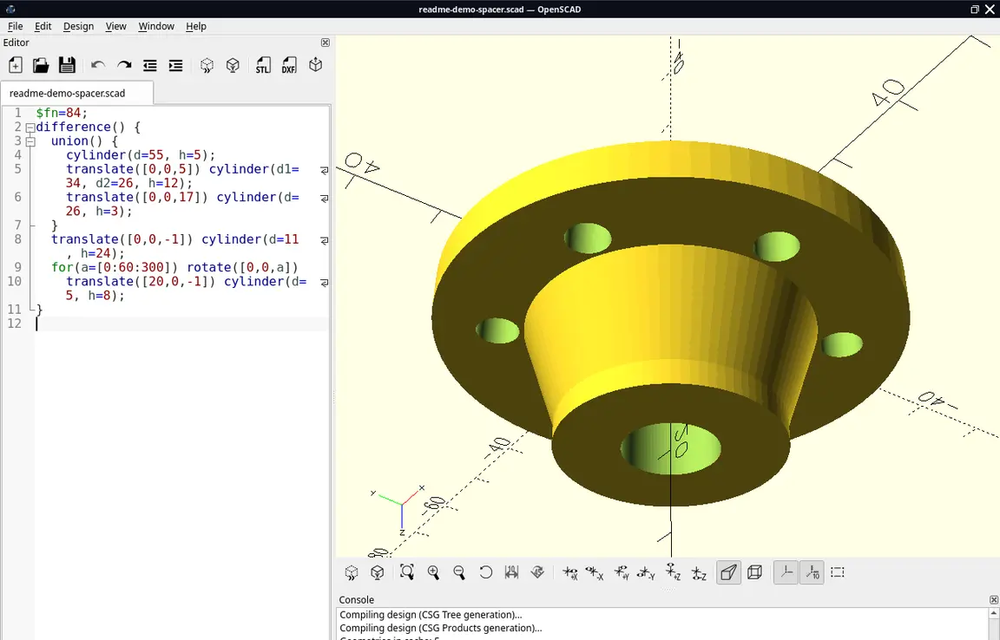
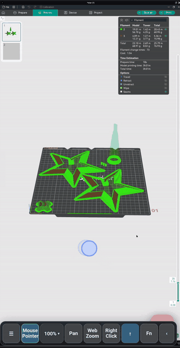
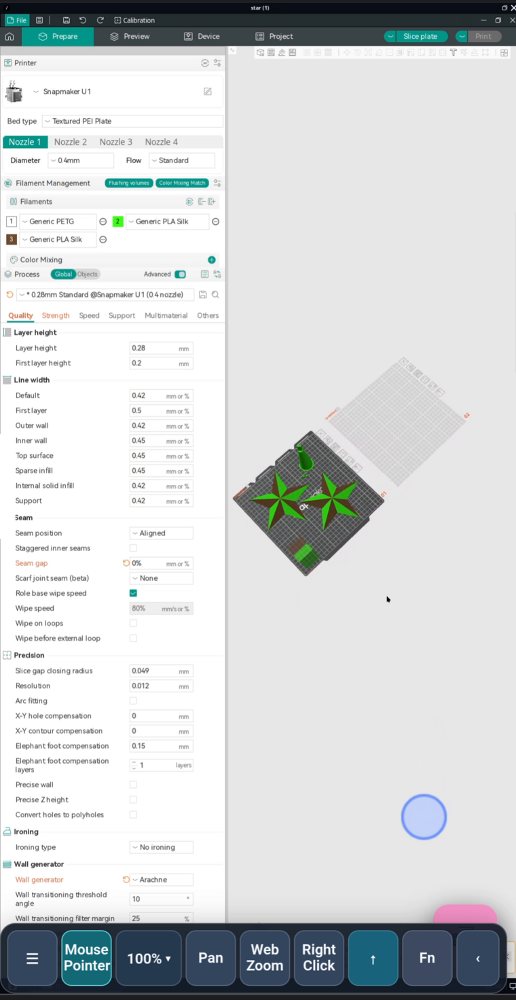
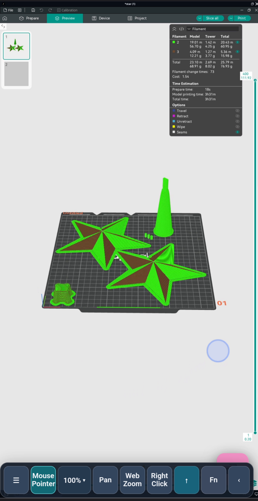
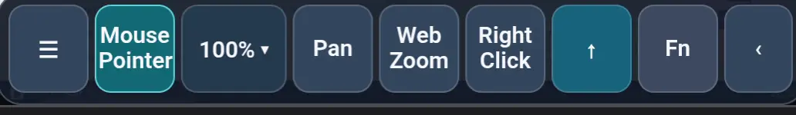

  

  <strong>Snapmaker Orca, OrcaSlicer, FOrcaSlicer and OpenSCAD in one self-hosted workspace.</strong> 
  The real desktop applications, streamed to whichever browser is closest.

  <a href="#see-it-running">See it running</a> &nbsp;·&nbsp;
  <a href="#a-phone-session-step-by-step">A phone session</a> &nbsp;·&nbsp;
  <a href="#the-workspace">The workspace</a> &nbsp;·&nbsp;
  <a href="#get-started">Get started</a> &nbsp;·&nbsp;
  <a href="#before-you-expose-it">Before you expose it</a>

  
  
  
  
  

---

## A slicer that lives on your desk — and opens anywhere

Sometimes the model is already on the computer, and the screen you actually have is a phone. Installing a full remote-desktop client just to nudge a part on the plate gets old fast.

Orca Online takes the short route: the actual Linux desktop slicers run inside a container, the desktop is streamed through [Selkies](https://github.com/selkies-project/selkies), and a thin touch layer sits on top for the handful of things a mouse does better.

No rewritten slicing engine. No reduced web clone. The same programs, with the same dialogs, in a browser tab.

## See it running

  

Snapmaker Orca 2.4.1 in a local test container: the spacer from [`examples/readme-spacer.scad`](examples/readme-spacer.scad) on a smooth high-temp plate. No mockup — this is the streamed desktop in a browser window.

<table>
  <tr>
    <td width="50%" valign="top">
       
      <strong>Work in the slicer</strong> 
      A few seconds of real camera movement on the plate.
    </td>
    <td width="50%" valign="top">
       
      <strong>Then model something</strong> 
      OpenSCAD with BOSL2: edit the script, preview, export, go back to slicing.
    </td>
  </tr>
</table>

## A phone session, step by step

  

One continuous phone recording, trimmed to a five-second loop and cropped to the slicer window. The dark bar along the bottom is the floating touch toolbar — menu, mouse pointer, zoom, pan, web zoom, right click — and it stays on screen the whole time; it gets its own section further down. Tap the loop for the [full four-minute session](assets/mobile-session.mp4) (MP4, 2.8 MB, no audio); this page's stills come from that recording.

The full recording walks through the whole loop, on a phone, with no desktop client:

| In the recording | What you are looking at |
|:---|:---|
| 0:00 | The workspace opens in Chrome, already on the Snapmaker Orca welcome screen, with the file manager behind it. |
| 0:35 | Prepare tab: printer, bed type, nozzle and process settings, exactly as on a desktop install. |
| 2:20 | A two-material test plate on the build plate, orbited and zoomed with the floating toolbar. |
| 3:15 | Slice preview with the filament summary and the time estimate in a panel over the plate. |
| 4:10 | Device tab: the printer's camera and a running job at 76%. |

Two full-size frames from the same session — the settings behind the plate, and the sliced result:

<table>
  <tr>
    <td width="50%" valign="top">
       
      Process settings are reachable without a mouse wheel.
    </td>
    <td width="50%" valign="top">
       
      The sliced result: filament totals, time estimate, layer slider.
    </td>
  </tr>
</table>

These are phone screenshots of the live stream, not renders. The interface is desktop software: the touch layer shortens the distance, it does not pretend every dialog was designed for a thumb.

## The workspace

| App | Version | What it is here for |
|:---|:---|:---|
| [Snapmaker Orca](https://github.com/Snapmaker/OrcaSlicer) | **2.4.1** | The default slicer when the desktop starts |
| [OrcaSlicer](https://github.com/OrcaSlicer/OrcaSlicer) | **2.4.2** | The upstream Orca experience, unmodified |
| [FOrcaSlicer](https://github.com/jiyang1018/FOrcaSlicer) | **2.3.2-fos.8.6.8** | Experimental fork, interesting for Snapmaker U1 users |
| [OpenSCAD](https://openscad.org/) + [BOSL2](https://github.com/BelfrySCAD/BOSL2) | **2026.11.01 nightly** | Parametric modeling next to the slicers |

Every program is launched from the Selkies Desktop applications menu. Each additional slicer gets its own `HOME`, so trying another build cannot overwrite the default Snapmaker Orca profile.

Versions are pinned and checksum-verified while the image builds. **FOrcaSlicer for Linux is experimental**: printer support and slicing results depend entirely on your configuration.

## How it fits together

<pre>
  phone or desktop browser
            │  WebRTC
            ▼
    Selkies desktop          ← src/mobile-index.html, src/mobile.js
            │
            ▼
       X11 + Openbox
            │
            ├── Snapmaker Orca 2.4.1
            ├── OrcaSlicer 2.4.2
            ├── FOrcaSlicer 2.3.2-fos.8.6.8
            └── OpenSCAD nightly + BOSL2
            │
            ▼
    /config  (volume: profiles, settings, Desktop)
</pre>

One container is one desktop with one user's files — and that is the reason the security section below exists.

## What you need

| | |
|:---|:---|
| **Host** | x86_64 Linux with Podman or Docker Compose |
| **Disk** | room for the image and a build cache; about 7 GB in our tested build |
| **Memory** | enough for the slicer plus your model; the compose file gives the container 2 GB of shared memory |
| **GPU** | optional. Without it the 3D viewport renders in software — slower, still usable |
| **Network** | a connection to the host while you work. This is a streamed desktop, not an offline app |

The first build downloads each application from its official release page and verifies the SHA-256 checksums in the [`Containerfile`](Containerfile).

## Get started

**Podman**

~~~bash
git clone https://github.com/Noty-design/Snapmaker_orca_online.git
cd Snapmaker_orca_online
./scripts/run-podman.sh
~~~

**Docker Compose**

~~~bash
git clone https://github.com/Noty-design/Snapmaker_orca_online.git
cd Snapmaker_orca_online
docker compose up --build -d
~~~

Then open **[https://127.0.0.1:3301](https://127.0.0.1:3301)** on the same machine. Selkies presents a self-signed certificate on first use; for anything beyond localhost, put a properly configured HTTPS reverse proxy or VPN in front of it.

Ports bind to loopback by default. The package also publishes a loopback HTTP origin on `127.0.0.1:3300` for a reverse proxy that terminates TLS itself.

### Settings

Create a `.env` next to `compose.yaml` (see [`.env.example`](.env.example)); `scripts/run-podman.sh` reads the same names from the environment.

| Variable | Default | Purpose |
|:---|:---|:---|
| `HOST_BIND` | `127.0.0.1` | Interface the published ports bind to |
| `HTTPS_PORT` | `3301` | Selkies TLS port, forwarded to container port 3001 |
| `HTTP_ORIGIN_PORT` | `3300` | Plain HTTP origin on loopback, forwarded to port 3000 |
| `PUID` / `PGID` | `1000` | Owner of the files in `/config` |
| `TZ` | `Etc/UTC` in compose | Container time zone |

Printer profiles, presets and models live in a named volume mounted at `/config` (`slicer_config` with Compose, `orca-web-config` with the Podman script), so rebuilding the image keeps your setup. Files dropped in `/config/Desktop` are the same folder the Selkies file manager shows.

## The touch toolbar

  

| Control | What it does |
|:---|:---|
| **☰** | Tap for the Selkies menu (files, clipboard, settings). Hold for half a second, then drag, to move the whole bar. |
| **Mouse Pointer / Direct Touch** | Switches between trackpad-style pointer movement and touching the remote desktop directly. |
| **100% ▾** | UI scale of the remote session, 100–300%, in DPI steps. Changing it reloads the page. |
| **Pan** | One-finger panning of the build plate. |
| **Web Zoom** | Browser zoom on the streamed image, independent of the slicer's own camera. |
| **Right Click** | Sends a right click at the remote pointer — context menus, without a mouse. |
| **↑** | Uploads an STL or 3MF from the device in your hand. |
| **Fn** | Opens Ctrl, Alt, Shift, Esc, Tab, Enter and Backspace. Double-tap a modifier to keep it held. |
| **‹** | Collapses the bar to a small handle at the left edge; tap again to bring it back. |

The bar remembers where you dragged it, and starts where it last was after a rotation. It sits above the stream rather than inside the desktop, so it never ends up behind a dialog.

## What is verified, and what is not

Being precise about this is part of the project:

- **Static source check.** [`scripts/verify.sh`](scripts/verify.sh) checks JavaScript syntax, shell syntax, that the expected files exist, that the Selkies web UI and toolbar are mounted in `compose.yaml`, and that no private hostnames, addresses, tokens or keys leaked into the checked files. CI runs exactly this on every push and pull request (the badge at the top).
- **Build.** The image build downloads pinned upstream releases and verifies their checksums. It runs when *you* build the image; CI does not build or publish it.
- **Runtime.** Starting the desktop, streaming video, the toolbar and the slicer itself are covered by manual testing — the screenshots and the recording above are from those runs. There is no automated end-to-end test, and this README does not claim a green runtime.

## Before you expose it

**The source is public. The desktop is not a public service.**

One container is one shared desktop with one filesystem, a terminal and administrator rights inside it. A visitor is not a “user account” — a visitor is you.

- Keep the published ports on loopback.
- Terminate TLS at an authenticated reverse proxy for personal remote access.
- Never mount private host folders or a container-engine socket into it.
- Do not commit certificates, session data, tokens or printer addresses.

A public, anonymous demo needs one disposable isolated environment per visitor — microVMs, quotas, no host binds, no internal networks, short session lifetimes. That gateway and isolation layer is **not included here**. [`docs/public-demo.md`](docs/public-demo.md) lists the launch requirements, [`docs/hosting.md`](docs/hosting.md) records the hosting investigation, and [`SECURITY.md`](SECURITY.md) the operational rules. Do not advertise a public demo until those pieces exist.

## Status and next

Public, working source for a trusted, single-user container. Not a hosted service, and no public demo URL exists.

The honest next step is the isolation layer: a session gateway that starts one short-lived sandbox per visitor, gives it its own `/config`, and destroys it afterwards. Everything else on this page works today.

## Credits & licenses

An **unofficial community integration**. Not affiliated with or endorsed by Snapmaker, OrcaSlicer, FOrcaSlicer, OpenSCAD or LinuxServer.

The glue code and the mobile UI in this repository are MIT-licensed. The applications keep their own upstream licenses, including AGPL-3.0 for the Orca forks — read [`THIRD_PARTY.md`](THIRD_PARTY.md) before redistributing built images.

---

Made for the simple pleasure of getting a print ready without walking back to the desk.

